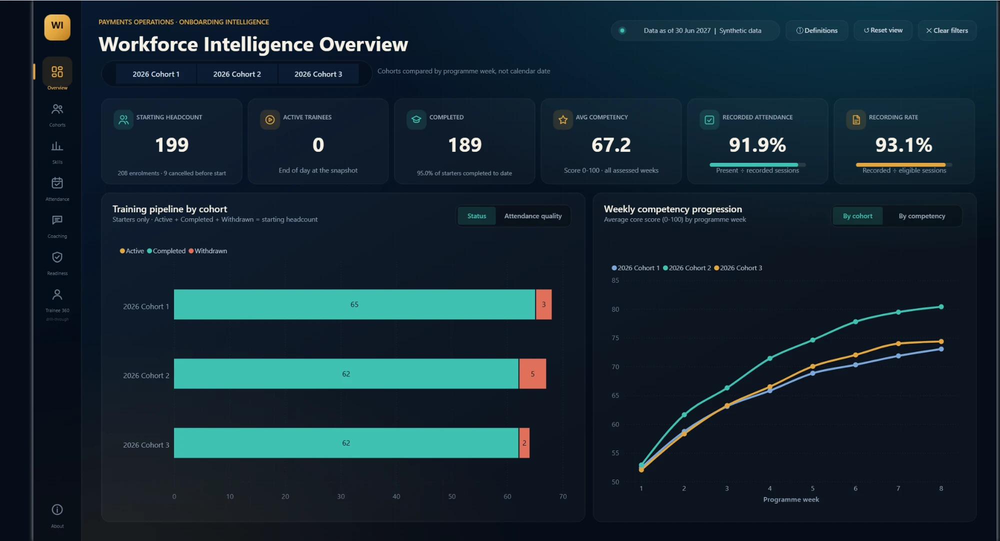
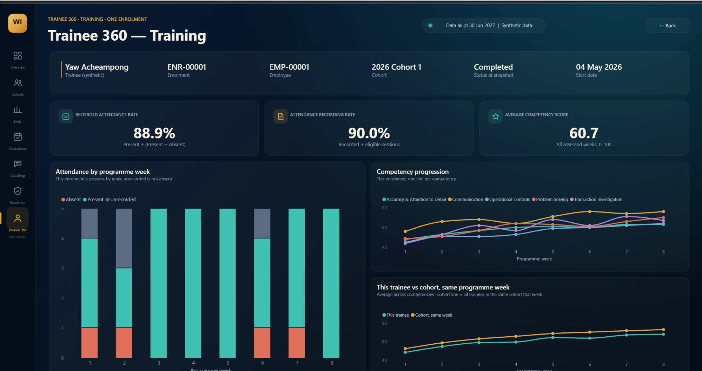
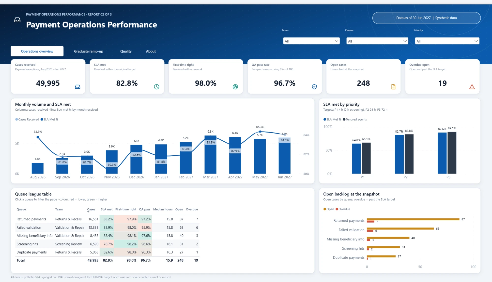
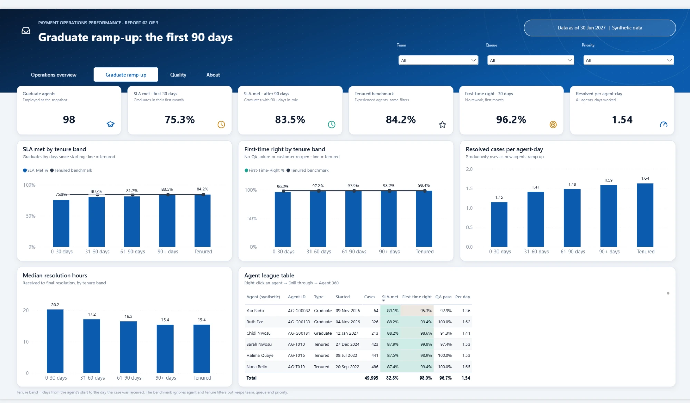
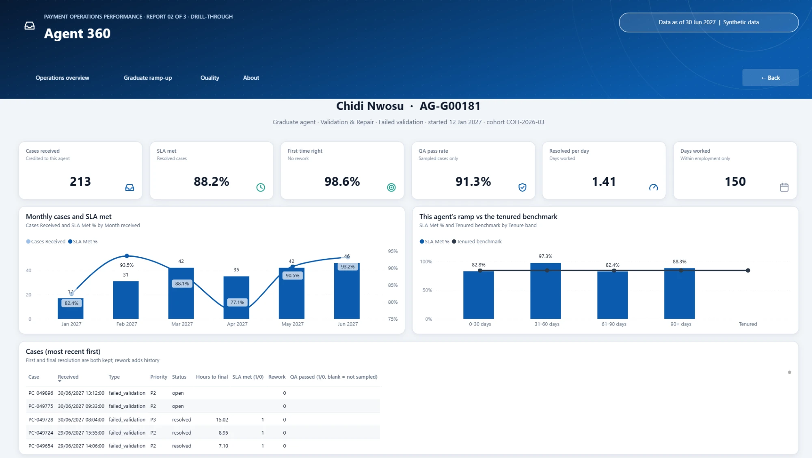
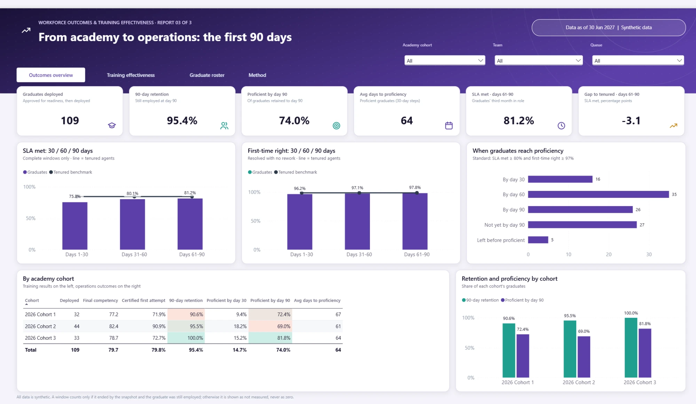
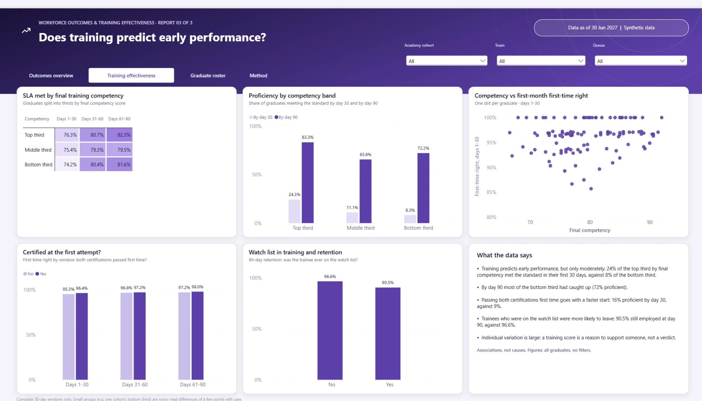
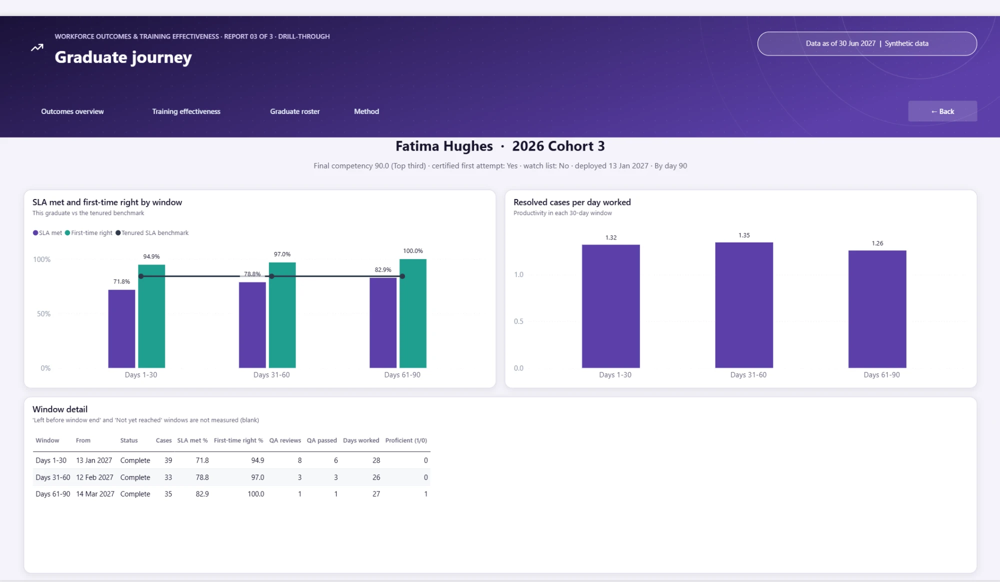
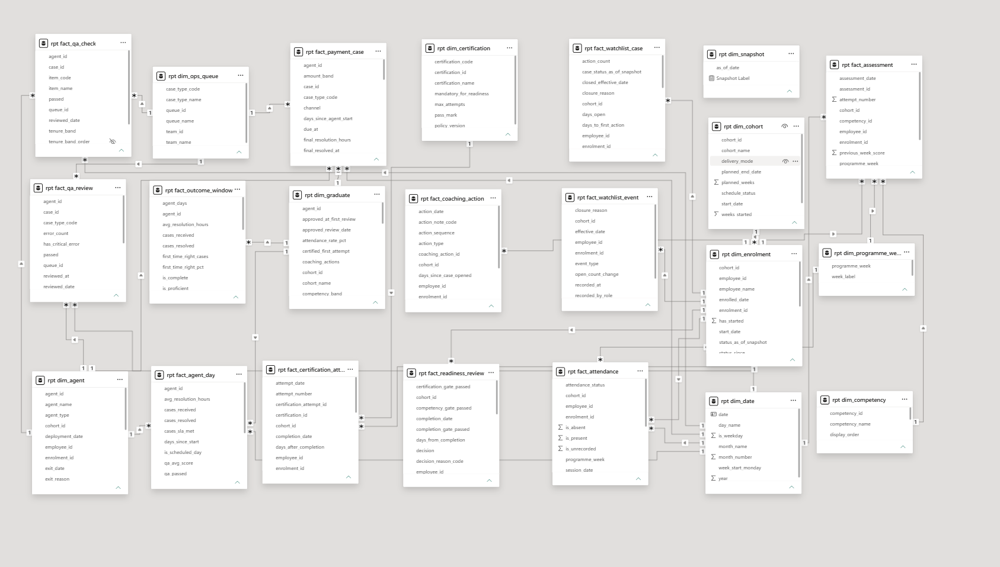

# Case study: Workforce Intelligence Suite

*From the training academy to the operations floor: does our training produce people who perform?*

**Role:** sole analyst and developer (portfolio project)
**Stack:** Python · MongoDB · SQL Server · Power BI (PBIP/TMDL, DAX) · pytest
**Data:** fully synthetic, for a fictional digital payments company

---

## The problem
A payments company trains new Operations Associates in 8-week cohorts, approves them for readiness and deploys them into a team that resolves payment exceptions: returned and duplicate payments, failed validations, missing beneficiaries and sanctions-screening hits.

Three groups of leaders ask three different questions:
- **Academy managers:** who is progressing, who needs coaching, who is ready?
- **Operations managers:** are we meeting SLA, is quality holding, and how long do new people take to get up to speed?
- **The leadership team:** is the academy working? Do the people it approves actually perform, and does what we see in training predict it?

Usually those answers sit in three disconnected tools. This project joins them.

## What I built
**Three Power BI reports on one shared semantic model.**
- **Workforce Development & Readiness:** cohorts, competencies, attendance (with *unrecorded* kept separate from *absent*), coaching watch list, certifications, readiness approvals, and a Trainee 360 drill-through.
- **Payment Operations Performance:** SLA, first-time right, QA, backlog, and the graduate ramp-up against a tenured benchmark, with an Agent 360 drill-through.
- **Workforce Outcomes & Training Effectiveness:** each graduate's first 30 / 60 / 90 days, proficiency, retention, and how training results relate to them, with a Graduate journey drill-through.

**A real multi-source pipeline.**
- **Training records** are relational (CSV → SQL Server).
- **Payment cases live in MongoDB as JSON documents**, as a case-management system would hold them, with nested events, QA checklists and rework history.
- **A Python ETL** loads them incrementally into SQL Server:
  - it uses an `(updated_at, _id)` checkpoint that copes with tied timestamps and resumes after a crash;
  - each case is replaced as a whole, so runs are idempotent;
  - malformed documents are rejected with a reason;
  - the result is reconciled against MongoDB.

**Data you can trust because it's tested.**
- 171 automated tests.
- SQL check suites for every build.
- A model check that proves new work never changed an existing measure.

## Design decisions that matter
- **Honest denominators:**
  - an open case is never counted as an SLA miss;
  - an unsampled case is never counted as a QA pass;
  - a graduate who left in month two has no month-three score, rather than a zero.
- **One definition per metric:** all three reports share one model, so *SLA Met %* means the same thing everywhere.
- **Benchmarks that compare like with like:** the tenured benchmark ignores agent and tenure filters but keeps team, queue and priority.
- **Built as code:**
  - the model's tables are generated from the SQL views, so the two can't drift apart;
  - report pages are generated and checked against Microsoft's schemas and the model;
  - one command rebuilds the whole database in about a minute.

## What the data shows (synthetic, 30 Jun 2027)
- **Ramp-up:**
  - new graduates meet SLA on **75%** of cases in their first month, against **84%** for experienced agents;
  - the gap is under 1 point after 90 days;
  - productivity rises from **1.1** to **1.6** resolved cases per day.
- **Proficiency:** **74%** of graduates still employed at day 90 reach the proficiency standard by then, after **64 days** on average.
- **Training predicts, but moderately:**
  - **24%** of the top third by final training competency meet the standard in their first 30 days, against **8%** of the bottom third;
  - by day 90, most of the bottom third have caught up (**72%**);
  - passing both certifications first time goes with a faster start (**16%** vs **9%** proficient by day 30).
- **Retention:** trainees who needed the coaching watch list were more likely to leave in their first 90 days (**90.5%** vs **96.6%** retained).
- **So what:**
  - **Use training scores to target support in the first 60 days, not to screen people out.** The weakest trainees mostly catch up.
  - Treat the watch list as an early retention signal.

These are associations in a simulated organisation, not causal claims. The simulation deliberately builds in a moderate link with large individual variation, as real studies typically find.

## Screenshots
*All screenshots were taken in Power BI Desktop, on synthetic data as at 30 Jun 2027.*

**Report 01: Workforce Development & Readiness**

**Report 02: Payment Operations Performance**

**Report 03: Workforce Outcomes & Training Effectiveness**

**One shared semantic model**

## What I'd do next at scale
- **Materialise the agent-day and outcome tables** during the ETL rather than as views.
- **Use change streams** instead of polling MongoDB.
- **Publish to the Power BI Service** with incremental refresh and row-level security by team.
- **Replace the synthetic training link** with a proper evaluation design: a hold-out cohort or a staggered rollout.
